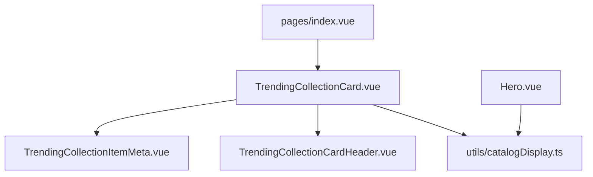

# Home UI components — DRY analysis (post–TrendingCollectionCard refactor)

**Status:** Implemented (Nov 2025).

## Summary of changes

| Deliverable | Path | Purpose |
|-------------|------|---------|
| Shared meta helpers | [utils/catalogDisplay.ts](../utils/catalogDisplay.ts) | Year, rating, genre, release badge, `trendingItemHasMeta` |
| Unit tests | [utils/catalogDisplay.test.ts](../utils/catalogDisplay.test.ts) | Year + hasMeta + first genre |
| Item meta UI | [components/TrendingCollectionItemMeta.vue](../components/TrendingCollectionItemMeta.vue) | One template for banner / narrow / grid meta; `align: 'start' \| 'center'` |
| Card header UI | [components/TrendingCollectionCardHeader.vue](../components/TrendingCollectionCardHeader.vue) | `layout: 'banner' \| 'compact'` |
| Parent slim-down | [components/TrendingCollectionCard.vue](../components/TrendingCollectionCard.vue) | ~525 → ~310 lines; meta class constants removed |
| Hero | [components/Hero.vue](../components/Hero.vue) | Uses `trendingItemYearLabel` |

**Deferred (out of scope):** NavBar config links, empty-state merge, skeleton header partial, MovieCollectionCard shell.

---

## Architecture

---

## What improved in TrendingCollectionCard

### Removed from parent script

- Local `yearLabel`, `ratingLabel`, `firstGenre`, `hasMeta`, `releaseDateBadgeLabel`
- Class constants used only by duplicated meta markup: `ratingInlineClass`, `starIconClass`, `ratingTextClass`, `metaLineClass`, `releaseDateBadgeClass`, `itemMetaStackClass`, `itemMetaStackCenteredClass`

### Retained in parent (layout-specific)

- `cardShellClass`, `rowShellClass`, rank flags, upcoming poster grid helpers
- Skeleton templates (unchanged structure)
- `itemMeta(item)` + `itemShowsMeta(item)` bridge to child with precomputed strings

### Performance

- Same `topThreeRanked` / `topFiveRanked` computeds
- Meta child has no `useI18n`; parent passes formatted strings once per visible item
- 3–5 meta component instances per card — negligible overhead

---

## `catalogDisplay` API

- `trendingItemYearLabel(item)`
- `trendingItemRatingLabel(item)`
- `trendingItemFirstGenre(item, languageOrLocale)`
- `trendingItemReleaseBadge(item, languageOrLocale, showReleaseDate)`
- `trendingItemHasMeta(item, languageOrLocale, showReleaseDate)`

**Note:** Utils use relative imports for vitest (`./formatMovieRating`, `../domain/locale/tmdbGenreLabels`); Nuxt resolves these normally.

---

## NavBar / Hero / composables (unchanged recommendations)

- **NavBar:** leave explicit links until nav grows
- **Hero:** carousel, preload, trailer state stay local; only year label shared
- **Composables:** do not merge trending vs upcoming fetchers

---

## Remaining low-priority opportunities

| Item | Notes |
|------|--------|
| Skeleton header partial | Share USkeleton blocks between variants |
| Empty / no-poster | Single template + computed message |
| `useCatalogTrailerAttempt` | Only if a second multi-item trailer carousel appears |
| `MovieCollectionCard` chevron | Wait for third card type |

---

## Verification done

- `npm test -- utils/catalogDisplay.test.ts` — 6 tests passed
- Manual: home trending + coming soon at narrow and ≥700px widths recommended

---

## Deletion test

- **`TrendingCollectionItemMeta`:** Removing it restores ~120 lines of duplicated template — deep module.
- **`catalogDisplay`:** Removing it duplicates year/meta logic — worth keeping.
- **Variant `TrendingCollectionCard`:** Still correct single component for home grid.